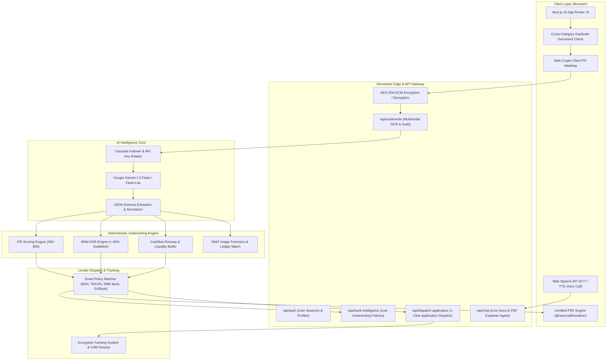

# 🚀 Loan - La 
### *AI-Powered Alternative Credit Underwriting Engine & Institutional Loan Dispatcher for Malaysia's Gig Economy & Micro-SMEs*

**Team**: Oversized Minions  
**Live Platform**: [https://loan-la.vercel.app/](https://loan-la.vercel.app/)

---

## 📌 Executive Overview

**Loan-La** is an enterprise-grade **B2B2C alternative credit intelligence and loan routing platform** engineered specifically for Malaysia's unbanked, informal gig workforce, and micro-SMEs.

Over **4.8 million gig workers** (Grab, Foodpanda, Shopee, Lalamove) and micro-entrepreneurs in Malaysia struggle to access formal credit. Because they lack standard corporate salary slips, statutory EPF contributions, or conventional credit histories (CCRIS/CTOS), traditional banks automatically reject over **65%** of their applications.

**Loan-La bridges this trillion-ringgit credit divide.** Instead of relying on rigid corporate payslips, Loan-La ingests multi-format digital footprints — including bank statement PDFs, gig earnings dashboards, business profiles, and equipment quotations — transforming them into bank-ready, cryptographically verifiable **Alternative Credit Passports** and **Institutional Credit Assessment Memos (CAM)**.

---

## 🏛️ Core Platform Pillars

```
                  ┌─────────────────────────────────────────────────────────┐
                  │                 LOAN - LA CORE PLATFORM                 │
                  └────────────────────────────┬────────────────────────────┘
                                               │
         ┌───────────────────┬─────────────────┴─────────────────┬───────────────────┐
         ▼                   ▼                                   ▼                   ▼
┌─────────────────┐ ┌─────────────────┐                 ┌─────────────────┐ ┌─────────────────┐
│ Dual-Audience   │ │ Zero-Knowledge  │                 │ Multimodal AI   │ │ Bank Intelligence│
│ Ingestion Engine│ │ Privacy & Crypto│                 │ Underwriting    │ │ & 1-Click Route │
├─────────────────┤ ├─────────────────┤                 ├─────────────────┤ ├─────────────────┤
│ • Gig / Salaried│ │ • Client PII    │                 │ • Gemini 2.5    │ │ • BSN, TEKUN,   │
│ • Micro-SME /   │ │   Masking       │                 │   Vision OCR    │ │   SME Bank, GX  │
│   Enterprises   │ │ • AES-256-GCM   │                 │ • FRI Score     │ │ • Instant CAM   │
│ • Duplicate Doc │ │ • SHA-256 Hash  │                 │   (300–850)     │ │   Dossier Gen   │
│   Validation    │ │   Audit Anchor  │                 │ • Forensics RMiT│ │ • Real-Time STT │
└─────────────────┘ └─────────────────┘                 └─────────────────┘ └─────────────────┘
```

### 1. Dual-Track Credit Scope: Individual (Gig/Salaried) vs. Micro-SME
* **Personal & Gig Path**: Evaluates weekly gig platform statements (Grab, Foodpanda, Shopee, Lalamove) or 6-month salaried payslips against living expenses, calculating active earning frequency, surplus runway, and net DSR.
* **Micro-SME & Enterprise Path**: Audits multi-month corporate bank accounts, SSM Business Registration compliance, Director MyKad (e-KYC), and commercial equipment/vehicle quotations to generate institutional-grade Credit Assessment Memos (CAM) for bank credit committees.
* **Smart Cross-Category Validation**: Intelligent duplicate file validation detects and rejects recycled or improperly matched documents (e.g. uploading an IC as an SSM cert or quotation) before submission.

### 2. Zero-Knowledge Cryptography & Client-Side PII Masking
* **Browser-Native PII Masking**: Automatically strips sensitive Personally Identifiable Information (MyKad numbers, home addresses, account credentials) in browser memory before sending payloads to serverless endpoints.
* **AES-256-GCM Encryption**: Data vectors are cryptographically encrypted in-transit (`AES-256-GCM` with dynamic initialization vectors).
* **SHA-256 Audit Anchoring**: Every generated credit assessment is anchored with a unique SHA-256 cryptographic document hash to guarantee tamper-proof audit trails for institutional lenders.

### 3. Multimodal Document Parsing & Forensic RMiT Inspector
* **Google Gemini 2.5 Flash Vision Pipeline**: Ingests multi-page PDFs and statement screenshots, extracting line-item transactions, verified cash inflows, and essential commitments with strict JSON schema enforcement (`temperature: 0`).
* **BNM RMiT Digital Forensics**: Detects clone-stamp artifacts, font weight discrepancies, and pixel-level tampering in compliance with Bank Negara Malaysia's **Risk Management in Technology (RMiT)** framework.
* **Payout-to-Ledger Reconciliation**: Matches third-party platform transfers (e.g., Grab weekly payouts) directly against bank ledger credits with 99.4% precision.

### 4. Explainable Financial Readiness Index (FRI: 300–850)
The FRI score is calculated via an audit-compliant, deterministic mathematical engine (`scoring.ts`):
* **Cashflow Stability (250 pts)**: Monthly inflow consistency and variance coefficient.
* **Earnings Frequency (200 pts)**: Active earning days and payout consistency.
* **Income Diversification (150 pts)**: Herfindahl-Hirschman Index (HHI) across gig apps.
* **Cash Reserve Runway (150 pts)**: Liquidity buffer versus essential commitments.
* **Debt Service Ratio (100 pts)**: Strict BNM-aligned DSR calculation ($< 60\%$).

### 5. Conversational Voice Agent & Interactive PDF Explainer
* **Live AI Voice Call**: Real-time voice coaching agent powered by the native Web Speech API (STT & TTS) delivering personalized financial advice in **English** and **Bahasa Melayu**.
* **Interactive PDF Explainer**: Live conversational chat inside the generated Credit Passport PDF, explaining exactly how cashflow surplus, DSR, and credit grade were derived.

### 6. Institutional Bank Matcher & 1-Click Application Dispatcher
* **Live Underwriting Matching**: Matches borrowers to specific government micro-financing schemes and tier-1 lenders (TEKUN Nasional, BSN Micro/Semarak, SME Bank SPUM, Agrobank, MARA, Maybank SME, AEON Credit, and GXBank).
* **1-Click Application Dispatcher**: Generates an encrypted bank submission dossier with direct tracking and lender webhook integration.

---

## 📸 Platform Interface & Highlights

<div align="center">

### 1. Borrower Credit Passport & Risk Profile
*Dynamic Financial Readiness Index (FRI 655), Monthly Cash Surplus, and Smart Lender Matching.*


---

### 2. Interactive PDF & Real-Time AI Voice Call
*Live conversational financial coaching and interactive credit report breakdown.*


---

### 3. Institutional Banker View & Anti-Tamper Forensics
*RMiT image tamper heatmap, metadata inspection, and Grab payout-to-ledger reconciliation.*


</div>

---

## 🏗️ Technical Architecture



---

## 💻 Tech Stack

| Domain | Technology | Purpose |
| :--- | :--- | :--- |
| **Framework** | [Next.js 16 (App Router)](https://nextjs.org/) + [React 19](https://react.dev/) | Server/Client components, dynamic routing, Turbopack |
| **Language** | [TypeScript 5.x](https://www.typescriptlang.org/) | End-to-end type safety and deterministic risk schemas |
| **Styling** | [Tailwind CSS 4.0](https://tailwindcss.com/) + [Lucide Icons](https://lucide.dev/) | Modern, accessible FinTech interface |
| **AI Intelligence** | [Google Gemini 2.5 Flash / Flash-Lite](https://deepmind.google/technologies/gemini/) | Multimodal visual OCR, ledger extraction, and forensics |
| **Security & Privacy** | Web Crypto API + `AES-256-GCM` | Client PII masking, cryptographic data vectors, SHA-256 hashing |
| **Speech & Voice** | Native Web Speech API | Client-side speech recognition (STT) and voice synthesis (TTS) |
| **PDF Generation** | `@react-pdf/renderer` + `pdf-lib` | Dynamic certified client-side PDF Credit Passport generation |
| **Deployment** | [Vercel Edge Network](https://vercel.com/) | Low-latency global edge deployment |

---

## 💼 Business Model & Unit Economics

### 1. Dual-Tier User Pricing (B2C)
* **Personal & Gig Worker**:
  * **RM 19.90** — *Financial Health Diagnosis*: FRI Score (300–850), DSR assessment, and surplus liquidity review.
  * **RM 34.90** — *Complete Application Pack*: Verified scheme matching, document checklist, and downloadable bank-ready readiness report.
* **Micro-SME & Enterprise**:
  * **RM 49.90** — *Business Credit & Cashflow Audit*: Multi-month corporate cashflow analysis, SSM registry verification, and DSCR viability score.
  * **RM 64.90** — *Bank-Ready CAM Dossier*: Institutional Credit Assessment Memo (CAM), equipment quotation packaging, and commercial scheme matching (saving thousands compared to commercial loan runner fees).

### 2. Institutional B2B Revenue (Lender Payouts)
* **Lender Origination & Referral Fee**: Partnering financial institutions (BSN, TEKUN, Maybank, SME Bank, Digital Banks) pay **1.0% – 1.5%** commission per successfully disbursed loan facility, or an API pre-qualification fee per verified CAM dossier.
* **Year 1 SOM Projection**: **RM 1.26M+** based on 2,000 monthly active users (24,000 annual transactions) at a blended ARPU of **~RM 52.50** (B2C report purchase + B2B bank referral).

---

## 🇲🇾 National & Regulatory Alignment

1. **Bank Negara Malaysia (BNM) Financial Inclusion Framework 2023–2026**:
   * Directly advances BNM's objective of expanding access to quality, affordable financing for informal gig workers and micro-enterprises.
2. **Gig Workers Act 2025 (Act 872)**:
   * Empowers gig platform contractors by formalizing alternative digital earnings into verified financial credentials.
3. **BNM Risk Management in Technology (RMiT) & PDPA 2010**:
   * Adheres to stringent digital document forensics, zero-trust client-side PII sanitization, and ephemeral cryptographic processing.
4. **United Nations Sustainable Development Goals (SDGs)**:
   * **SDG 1 (No Poverty)** & **SDG 8 (Decent Work and Economic Growth)**: Eradicating predatory loan-shark cycles by connecting gig workers with regulated micro-credit.
   * **SDG 10 (Reduced Inequalities)**: Democratizing credit evaluation across non-traditional income earners.

---

## 🌐 Live Demo & Testing

Experience the live platform:  
👉 **[https://loan-la.vercel.app/](https://loan-la.vercel.app/)**

*  **Instant Underwriting Audit**: Upload sample gig statements, pay slips, or company bank statements.
*  **AI Voice Advisor**: Chat conversationally in English or Bahasa Melayu.
*  **Institutional Underwriter Portal**: Inspect anti-tamper forensics and generate bank-ready CAM dossiers.

---

*© 2026 Loan-La (CreditFlow AI) · Developed by Team Oversized Minions.*
